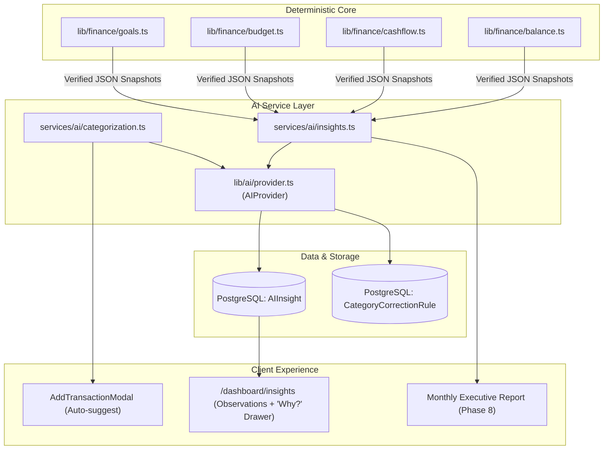

# Finance OS — AI Architecture & Integration Specification (Phase 7)

This document specifies the technical design, architectural invariants, database models, provider interfaces, and user experience for the background AI capabilities in **Finance OS**.

---

## 1. Core Philosophy & Non-Negotiable Invariants

Finance OS adheres to strict engineering rules regarding artificial intelligence:

1. **Zero Hallucination / Pure Mathematical Grounding**:
   - **AI never performs financial calculations, balance tracking, currency conversions, or budget allocations.**
   - All financial numbers are computed deterministically in application code (`lib/finance/*`) using `decimal.js`.
   - The AI engine is provided with verified, pre-computed numbers as structured JSON and is restricted to interpreting, contextualizing, and summarizing those verified facts.
2. **Background Assistant, Not a Chatbot**:
   - AI is **not** an open conversational chatbot interface.
   - AI operates strictly in the background for three specific tasks:
     1. Suggesting categories for transactions.
     2. Generating proactive, plain-language monthly financial observations.
     3. Writing executive end-of-month financial report summaries.
3. **Full Auditability & Transparency ("Why?" Drawer)**:
   - Every generated insight must link back to the exact deterministic data points that produced it (`AIInsight.reasoning`).
   - Users can click "Why?" on any insight to view the underlying math and data rows.
4. **Provider-Agnostic & Server-Isolated**:
   - AI integrations reside behind an abstract `AIProvider` interface.
   - API keys (e.g., `GEMINI_API_KEY`) stay strictly on the server in `.env`. The client browser never communicates directly with external AI services.
   - An offline mock provider (`MockAIProvider`) is maintained so automated test suites (`vitest`) run without network dependencies or API costs.
5. **Graceful Degradation**:
   - If an AI API call fails, times out, or hits rate limits, the system fails silently or falls back to rule-based heuristics without disrupting normal financial tracking.

---

## 2. Core Capabilities



### Capability 1: Smart Transaction Categorization
- **Trigger**: User types a description in [`AddTransactionModal`](../components/AddTransactionModal.tsx) or uploads a bank CSV statement.
- **Input Context**:
  - Transaction description, positive amount, and currency.
  - List of user's active categories (`id`, `name`).
  - Recent user categorization rules (`CategoryCorrectionRule`).
- **Output**:
  - Suggested `categoryId`.
  - Confidence score (`0.0` to `1.0`).
  - Short 1-sentence reasoning (e.g., `"Matched 'Carrefour' to Groceries & Food based on keyword rules"`).
- **Feedback Loop**: When a user overrides a category, the system saves a `CategoryCorrectionRule` so subsequent transactions from the same merchant/keyword categorize accurately without prompt re-engineering.

### Capability 2: Plain-Language Monthly Financial Insights
- **Trigger**: Navigating to [`/dashboard/insights`](../app/dashboard/insights/page.tsx) or clicking "Generate Insights" for the current month.
- **Input Context**:
  - Output of [`getDashboardSummary`](../services/dashboard/summary.ts) for `(year, month)`.
  - Output of [`getBudgetWithActuals`](../services/budget/budget.ts) for `(year, month)`.
  - Output of active [`listGoalsWithProgress`](../services/goal/goal.ts).
  - Comparison against the previous month's deterministic totals.
- **Output**: 3 to 5 structured observations classified by `InsightType`:
  - `SAVINGS_OPPORTUNITY`: Actionable areas where spending can be trimmed to fund goals.
  - `SPENDING_ALERT`: Category envelopes nearing or exceeding monthly limits.
  - `GOAL_PROGRESS`: Progress trajectories, milestone dates, and deadline status.
  - `CASH_FLOW_TREND`: Net cash flow direction and recurring income stability.
- **Auditability**: Each insight contains a structured `reasoning` payload holding the exact figures referenced.

### Capability 3: Executive Monthly Report Narrative
- **Trigger**: Generated at month-end as part of the Phase 8 report snapshot.
- **Output**: A 3-paragraph executive summary highlighting what went well, what slipped, and 3 high-priority action items for the upcoming month.

---

## 3. Database Schema Models

The following models are to be added to `prisma/schema.prisma`:

```prisma
enum InsightType {
  SAVINGS_OPPORTUNITY
  SPENDING_ALERT
  GOAL_PROGRESS
  CASH_FLOW_TREND
}

model AIInsight {
  id              String      @id @default(cuid())
  userId          String
  user            User        @relation(fields: [userId], references: [id], onDelete: Cascade)
  year            Int
  month           Int
  type            InsightType
  title           String
  summary         String
  actionableStep  String?
  reasoning       Json        // Verified underlying metrics (e.g. { spent: "4000.00", prevSpent: "6000.00" })
  isDismissed     Boolean     @default(false)
  createdAt       DateTime    @default(now())

  @@index([userId, year, month])
}

model CategoryCorrectionRule {
  id          String   @id @default(cuid())
  userId      String
  user        User     @relation(fields: [userId], references: [id], onDelete: Cascade)
  keyword     String   // Lowercased merchant/description keyword
  categoryId  String
  category    Category @relation(fields: [categoryId], references: [id], onDelete: Cascade)
  createdAt   DateTime @default(now())

  @@unique([userId, keyword])
  @@index([userId])
}
```

---

## 4. Provider-Agnostic Interface (`lib/ai/`)

### A. TypeScript Interface (`lib/ai/provider.ts`)

```typescript
export type CategorySuggestionResult = {
  categoryId: string;
  categoryName: string;
  confidence: number; // 0.0 to 1.0
  reason: string;
};

export type GeneratedInsightItem = {
  type: "SAVINGS_OPPORTUNITY" | "SPENDING_ALERT" | "GOAL_PROGRESS" | "CASH_FLOW_TREND";
  title: string;
  summary: string;
  actionableStep?: string;
  reasoning: Record<string, unknown>;
};

export interface AIProvider {
  suggestCategory(input: {
    description: string;
    amount: string;
    currency: string;
    categories: Array<{ id: string; name: string }>;
    correctionRules?: Array<{ keyword: string; categoryId: string; categoryName: string }>;
  }): Promise<CategorySuggestionResult | null>;

  generateMonthlyInsights(input: {
    period: { year: number; month: number };
    currency: string;
    summary: {
      income: string;
      spending: string;
      saved: string;
      invested: string;
      netCashFlow: string;
      spendingByCategory: Array<{ name: string; amount: string }>;
    };
    budget?: {
      totalAllocated: string;
      totalActual: string;
      categories: Array<{ name: string; allocated: string; actual: string; isOverBudget: boolean }>;
    } | null;
    goals: Array<{
      name: string;
      targetAmount: string;
      currentAmount: string;
      percentComplete: string;
      status: string;
    }>;
  }): Promise<GeneratedInsightItem[]>;
}
```

### B. Implementations
1. **`GeminiProvider` (`lib/ai/gemini.ts`)**:
   - Uses the official Google Gen AI SDK (`@google/genai`).
   - Uses `gemini-2.5-flash` for high-speed, cost-effective structured JSON reasoning.
   - Uses `responseSchema` for guaranteed JSON structure validation.
2. **`MockAIProvider` (`lib/ai/mock.ts`)**:
   - Evaluates keyword matching and heuristic rules deterministically without network calls.
   - Default provider used in Vitest unit tests.

---

## 5. REST API & Server Action Endpoints

### REST Endpoints (`app/api/ai/**`)
1. **`POST /api/ai/categorize`**
   - Request Body: `{ description: string, amount: string, currency: string }`
   - Response (`200`): `{ suggestion: CategorySuggestionResult | null }`
2. **`GET /api/ai/insights?year=2026&month=11`**
   - Response (`200`): `{ insights: AIInsight[] }`
3. **`POST /api/ai/insights/generate`**
   - Request Body: `{ year: number, month: number }`
   - Response (`201`): `{ insights: AIInsight[] }`
4. **`PATCH /api/ai/insights/[insightId]/dismiss`**
   - Marks an insight as dismissed (`isDismissed: true`).
   - Response (`200`): `{ success: true }`

### Server Actions (`app/insights/actions.ts`)
- **`generateInsightsAction(year: number, month: number)`**: Generates, stores, and revalidates `/dashboard/insights`.
- **`dismissInsightAction(insightId: string)`**: Dismisses an insight and revalidates `/dashboard/insights`.
- **`saveCategoryCorrectionAction(keyword: string, categoryId: string)`**: Upserts a keyword rule for future categorizations.

---

## 6. Frontend User Experience (`/dashboard/insights`)

The dedicated Insights screen displays:
1. **Period Header & Monthly Selector**: Switch between months to review historical AI insights.
2. **Key Insight Cards**:
   - Styled cards matching the Finance OS theme (`#0F5147`, clean borders, pill badges by `InsightType`).
   - Distinct icons and badge colors:
     - `SAVINGS_OPPORTUNITY`: Emerald badge with PiggyBank icon.
     - `SPENDING_ALERT`: Amber/Rose badge with Warning/Target icon.
     - `GOAL_PROGRESS`: Teal badge with TrendUp icon.
     - `CASH_FLOW_TREND`: Sky badge with Flow icon.
   - Actionable step pill with practical advice.
3. **Interactive "Why?" Drawer / Modal**:
   - Clicking "Why this insight?" expands an inspection drawer displaying the verified mathematical inputs (e.g., category comparisons, savings rates, goal deadlines) that generated the observation.
4. **Dismiss & Feedback Controls**:
   - Allows users to dismiss unhelpful insights.

---

## 7. Phased Implementation Roadmap

| Step | Scope | Deliverables |
|---|---|---|
| **Phase 7.1** | Infrastructure & Types | `lib/ai/provider.ts`, `lib/ai/gemini.ts`, `lib/ai/mock.ts`, Vitest tests |
| **Phase 7.2** | Schema & Database | Prisma migration for `AIInsight` and `CategoryCorrectionRule` |
| **Phase 7.3** | Categorization Service | `services/ai/categorization.ts`, auto-suggest integration in `AddTransactionModal.tsx` |
| **Phase 7.4** | Insights Service & Actions | `services/ai/insights.ts`, `app/insights/actions.ts`, API routes |
| **Phase 7.5** | UI Implementation | `app/dashboard/insights/InsightsClient.tsx` with "Why?" inspection drawer |
| **Phase 7.6** | Verification | `tsc --noEmit`, ESLint, full test suite pass |

