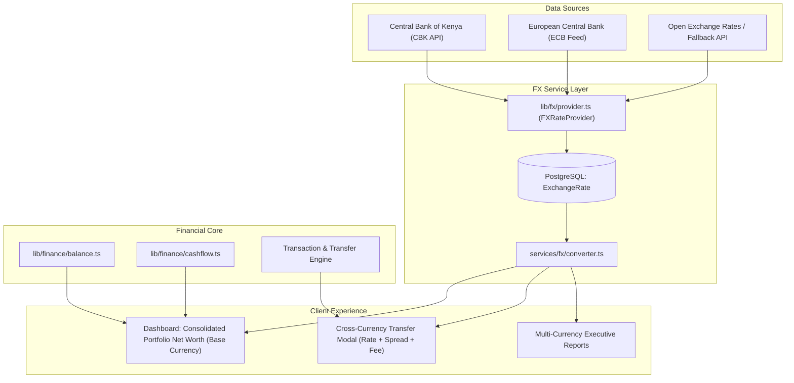

# Finance OS — Multi-Currency & Foreign Exchange (FX) Architecture

This document outlines the current architectural model for multi-currency handling in **Finance OS**, and specifies the technical design, database models, mathematical invariants, and user experience for the **Future FX & Currency Conversion Engine**.

---

## 1. Current Multi-Currency Isolation Model (Phase 1–5)

Finance OS was architected from day one with financial accuracy and zero-hallucination invariants. In financial systems, silently converting or summing different currencies using arbitrary or outdated exchange rates leads to inaccurate balance sheets, phantom profits/losses, and loss of trust.

### Architectural Rules & Invariants
1. **Isolation by Currency (No Blending)**:
   - The platform supports four core ISO currencies: `KES`, `EUR`, `USD`, `GBP`.
   - Each financial account exists in exactly one native currency (`Account.currency`).
   - Every transaction row must match its account's native currency (`Transaction.currency === Account.currency`).
   - Currency totals are computed **in parallel**, never mixed. For example, a user with `KSh 30,000.00` in a KCB account and `€300.00` in a BNP Paribas account has their net available cash reported as:
     $$\text{Net Available} = \text{KSh } 30,000.00 \ + \ €300.00$$
2. **Deterministic Cashflow & Budgets**:
   - Monthly cashflow calculations (`services/dashboard/summary.ts`) produce a structured `byCurrency` map holding separate deterministic cashflows for each active currency.
   - Monthly budgets (`Budget` model) enforce a unique constraint `@@unique([userId, year, month, currency])`. A user budgeting in `KES` has a dedicated KES envelope budget; an expat or remote freelancer budgeting in `EUR` has an independent EUR envelope budget.
3. **Cross-Currency Transfer Restrictions**:
   - Transfers between accounts with different currencies throw `CurrencyMismatchError` (`422 Unprocessable Entity`), preventing unintentional cross-currency balance corruption without an explicit exchange rate.
4. **Role of `User.baseCurrency`**:
   - Acts as the user's primary workspace reporting lens.
   - Sets the initial default for creating new accounts and transactions.
   - Determines the primary budget view loaded on `/dashboard/budgets`.
   - Can be toggled on demand via the Header currency switcher without altering underlying account data.

---

## 2. Future FX & Currency Conversion Architecture (Roadmap)

When cross-currency conversion is introduced, it must follow strict mathematical determinism, transparent audit trails, and auditable exchange rate histories.



---

## 3. Database Schema Extensions

The following models and field extensions will be added to `prisma/schema.prisma`:

```prisma
model ExchangeRate {
  id            String    @id @default(cuid())
  fromCurrency  Currency
  toCurrency    Currency
  rate          Decimal   @db.Decimal(18, 6) // e.g. 1 EUR = 142.503400 KES
  source        String    // e.g. "CBK", "ECB", "MANUAL"
  rateDate      DateTime  // Date for which the rate applies
  fetchedAt     DateTime  @default(now())

  @@unique([fromCurrency, toCurrency, rateDate])
  @@index([rateDate])
}

// Extension to Transaction model for Cross-Currency Transfers
// Added to model Transaction:
//   transferRate         Decimal?  @db.Decimal(18, 6)
//   transferFeeAmount    Decimal?  @db.Decimal(14, 2)
//   transferFeeCurrency  Currency?
//   destinationAmount    Decimal?  @db.Decimal(14, 2)
//   destinationCurrency  Currency?
```

---

## 4. Mathematical Determinism & Invariants

1. **Decimal Precision Rule**:
   - Exchange rates are stored with 6 decimal places: `Decimal(18, 6)`.
   - Converted currency amounts are rounded to 2 decimal places using Banker's Rounding (Round Half to Even):
     $$\text{DestinationAmount} = \text{round}_{2}\left( \text{SourceAmount} \times \text{ExchangeRate} \right) - \text{TransferFee}$$
2. **Explicit User Confirmation**:
   - The system will never convert funds silently or implicitly.
   - When initiating a transfer between a EUR account and a KES account, the user must explicitly view and confirm:
     1. Source Amount (e.g. `€500.00`)
     2. Applied Exchange Rate (e.g. `1 EUR = 142.50 KES`)
     3. Transfer / Platform Fee (e.g. `€2.50` or `KSh 350.00`)
     4. Final Credited Destination Amount (e.g. `KSh 70,893.75`)
3. **Auditable Transfer Records**:
   - Both debit from the source account and credit to the destination account will be committed in a single atomic database transaction (`prisma.$transaction`).
   - The exchange rate and any transaction fee applied at execution time are permanently preserved on the transaction record for historical auditing.

---

## 5. Provider-Agnostic Interface (`lib/fx/`)

```typescript
export interface FXRate {
  fromCurrency: Currency;
  toCurrency: Currency;
  rate: Decimal;
  rateDate: Date;
  source: string;
}

export interface FXRateProvider {
  /**
   * Retrieves the exchange rate between two currencies for a specific date (defaults to today).
   */
  getExchangeRate(from: Currency, to: Currency, date?: Date): Promise<FXRate>;

  /**
   * Retrieves all latest rates relative to a given base currency.
   */
  getLatestRates(base: Currency): Promise<Record<Currency, Decimal>>;
}
```

### Provider Implementations
1. **`CentralBankKenyaProvider`**: Fetches daily official mean, buy, and sell rates published by the Central Bank of Kenya (ideal for KES pairings).
2. **`EuropeanCentralBankProvider`**: Daily reference exchange rates published by the ECB.
3. **`MockFXRateProvider`**: Static, offline rates table used in automated test suites (`vitest`).

---

## 6. Frontend User Experience Extensions

### A. Consolidated Portfolio Net Worth (Dashboard)
- In addition to showing per-currency cash balances, the dashboard header will display an optional **Consolidated Total**:
  > **Total Estimated Net Worth**: `KSh 113,500.00`
  > *(Converts €300.00 @ 142.50 KES + KSh 70,750.00 as of Nov 1, 2026)*
- A breakdown tooltip clearly shows the native amounts, rates applied, and conversion timestamps so the user retains complete visibility into how the aggregate number was formed.

### B. Cross-Currency Transfer Dialog
- When a user selects a source account in `EUR` and a destination account in `KES`:
  - An interactive conversion preview card appears.
  - Shows the real-time indicative rate with an option to override with the exact rate quoted by the user's remittance service (e.g., Wise, Remitly, Western Union, M-Pesa Global).
  - Displays the fee input and exact net amount to be credited.

---

## 7. Phased Implementation Roadmap

| Milestone | Deliverables |
|---|---|
| **Milestone FX.1** | `ExchangeRate` Prisma schema, migration, and `FXRateProvider` interface |
| **Milestone FX.2** | CBK/ECB daily rate sync background job and caching layer with TTL |
| **Milestone FX.3** | Consolidated base-currency portfolio estimation widget on Dashboard |
| **Milestone FX.4** | Atomic cross-currency transfers in `createTransaction` with fee tracking |
| **Milestone FX.5** | Unit and integration test suites for all FX conversion math |

